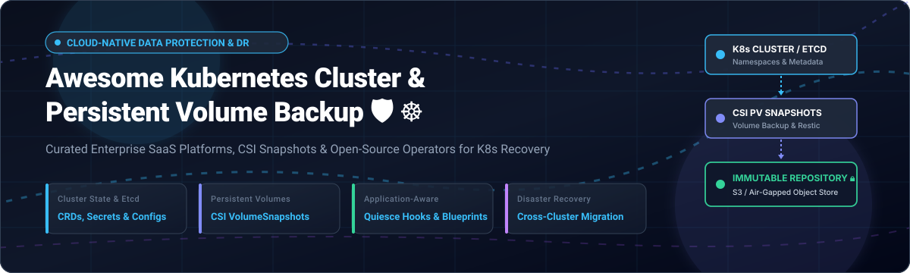

# Awesome Kubernetes Cluster & Persistent Volume Backup 🛡️ ☸️

<p align="center">
  
</p>

<p align="center">
  <a href="https://github.com/ishandutta2007/Awesome-Awesome-Awesome"></a><a href="https://discord.gg/jc4xtF58Ve"></a>
  <a href="https://github.com/ishandutta2007/Awesome-Kubernetes-Cluster-Persistent-Volume-Backup/stargazers"></a>
  <a href="https://github.com/ishandutta2007/Awesome-Kubernetes-Cluster-Persistent-Volume-Backup/network/members"></a>
  <a href="https://github.com/ishandutta2007/Awesome-Kubernetes-Cluster-Persistent-Volume-Backup/blob/main/LICENSE"></a>
</p>

---

## 🧭 Executive Overview & SEO Guide

Welcome to the definitive, curated directory of **Kubernetes Cluster State and Persistent Volume (PV) Backup, Restore, and Disaster Recovery (DR)** solutions. 

As stateful workloads—including distributed databases (PostgreSQL, MySQL, Cassandra), messaging queues (Kafka, RabbitMQ), and AI/ML model caches—increasingly migrate to **Kubernetes (K8s)**, reliable data protection is mission-critical. Modern container backup goes far beyond traditional VM image snapshots: it requires **application-consistent quiescing**, orchestrating **Container Storage Interface (CSI) VolumeSnapshots**, streaming deduplicated data to immutable object stores (Amazon S3, Azure Blob, Google Cloud Storage, MinIO), and capturing declarative Kubernetes metadata (etcd, CRDs, Helm charts, ConfigMaps, and Secrets).

Whether you are designing a cross-region failover pipeline, migrating stateful pods across clusters, or defending against ransomware with air-gapped repositories, this directory compares leading **commercial SaaS / hosted enterprise data protection suites** and **battle-tested open-source Kubernetes backup engines**.

---

## 📑 Table of Contents
- [Sector Overview & Market Dynamics](#-sector-overview--market-dynamics)
- [Enterprise SaaS & Hosted Platforms](#-enterprise-saas--hosted-platforms)
- [Open-Source Kubernetes Backup & Storage Ecosystem](#-open-source-kubernetes-backup--storage-ecosystem)
- [Architectural Patterns & Selection Guide](#-architectural-patterns--selection-guide)
- [How to Contribute](#-how-to-contribute)
- [License & Disclaimer](#-license--disclaimer)

---

## 📊 Sector Overview & Market Dynamics

The global **Kubernetes Backup and Cloud-Native Recovery Software market** is estimated at approximately **$1.02 Billion in 2026** and is projected to surge to **$2.69 Billion by 2030**, advancing at a compound annual growth rate (**CAGR**) of **27.4%**. 

The sector displays **moderate fragmentation transitioning toward consolidation**: while cloud-native pure-plays (such as Kasten, Portworx, Trilio, and CloudCasa) initially pioneered CSI-native snapshots and application-aware Kubernetes primitives, dominant enterprise data protection conglomerates (Pure Storage, Veeam Software, Commvault, Rubrik, and Cohesity) have aggressively acquired or expanded their core platforms to capture the enterprise container protection market.

---

## 🏢 Enterprise SaaS & Hosted Platforms

The table below catalogs premier commercial and SaaS data resilience platforms offering dedicated Kubernetes cluster state and persistent volume data protection, sorted in descending order by **Company Scale (Valuation / Market Capitalization / Annual Revenue)**.

| Product / Platform | Company Scale (Valuation / Revenue) | Starting Pricing (Specific Tier) | Free Tier / Trial Limit | Key Capabilities & Architecture |
| :--- | :--- | :--- | :--- | :--- |
| **[Portworx PX-Backup (Pure Storage)](https://portworx.com/products/px-backup/)** ☁️ | **$23.5B Valuation** / $3.2B ARR *(NYSE: PSTG)* | **$0.20 per worker node/hour** (~$144/node/month on AWS Marketplace) | **30-day full-featured free trial**; unmetered evaluation across unlimited test clusters | Complete application container lifecycle protection, multi-cloud PVC data mobility, and granular CSI volume snapshot catalogs. |
| **[Rubrik Security Cloud for Kubernetes](https://www.rubrik.com/solutions/kubernetes-backup)** 🛡️ | **$22.0B Valuation** / $1.4B ARR *(NYSE: RBRK)* | **~$150 - $250 per protected TB/year** (Enterprise capacity licensing) | **Guided 30-day Proof of Concept (PoC)**; no public perpetual free tier | Zero-trust data security, immutable air-gapped backups, ransomware threat monitoring, and automated K8s namespace discovery. |
| **[Kasten K10 (Veeam Software)](https://www.kasten.io/)** 📦 | **$15.0B Valuation** / $2.0B+ ARR *(TPG / Insight Partners)* | **~$1,200 per worker node/year** (~$100/node/month via enterprise subscription) | **Perpetual Free Tier up to 5 worker nodes**; unrestricted 50-node access during first 30 days | Native Kubernetes API integration, Kanister application blueprints, multi-cluster dashboard, and direct Veeam VBR export. |
| **[Cohesity DataProtect for Kubernetes](https://www.cohesity.com/solutions/cloud/kubernetes/)** 🔒 | **$8.0B Valuation** / $1.6B ARR *(Cohesity + Veritas)* | **~$150 - $400 per front-end TB (FETB)/year** (SaaS & software tiers) | **30-day free trial** for Cohesity DataProtect as a Service; full workload evaluation | Unified multi-cloud data protection, global source-side deduplication, instantaneous namespace recovery, and ransomware isolation. |
| **[Commvault Cloud for Kubernetes](https://www.commvault.com/supported-technologies/kubernetes)** 🗄️ | **$6.2B Valuation** / $1.25B ARR *(NASDAQ: CVLT)* | **$90 per front-end TB (FETB)/month** ($1,080/TB/year via AWS Marketplace) | **30-day free trial** with access to Commvault Cloud command center and 1 TB trial quota | Comprehensive enterprise hybrid coverage, Air-Gap Protect cloud storage integration, and automated disaster recovery orchestration. |
| **[Druva Data Resilience Cloud for Kubernetes](https://www.druva.com/solutions/kubernetes-backup/)** ⚡ | **$2.0B Valuation** / ~$150M ARR *(Private Equity / Growth)* | **~$200 - $300 per TB/year** (~$20 - $25 per consumption credit/TB-month) | **30-day free trial** (up to 1 TB protected data, extendable up to 60 days via sales inquiry) | 100% agentless SaaS architecture, zero infrastructure maintenance, cross-region replication, and automated anomaly detection. |
| **[TrilioVault for Kubernetes (TVK)](https://trilio.io/triliovault-kubernetes/)** 🧩 | **$68M Valuation** / ~$3.5M ARR *(Series B)* | **$1,000 per node/year** (1 node = 4 vCPUs via AWS Marketplace) | **Perpetual Free Basic Edition up to 10 nodes**; 30-day unrestricted Enterprise trial | CRD-native management, Red Hat OpenShift certification, Velero migration assistance, and intuitive GitOps restore workflows. |
| **[CloudCasa (Catalogic Software)](https://cloudcasa.io/)** 🚀 | **~$20M Valuation** / SMB Mid-Market *(Catalogic Software)* | **$79 per worker node/month** (Plus optional storage at $0.05/GB-month) | **Perpetual Free Plan** (unlimited clusters for K8s configuration/resource backups; PV backups require Pro) + 60-day Pro trial | Centralized SaaS management plane, multi-cloud EKS/GKE/AKS/OCP support, Velero dashboard management, and vulnerability scanning. |

---

## 💻 Open-Source Kubernetes Backup & Storage Ecosystem

Open-source technologies power the modern cloud-native storage and disaster recovery paradigm. The repositories below are sorted in descending order by **GitHub Star Count**, featuring direct links to each project's stargazers community.

| Project & Repo Link | GitHub Stars ⭐ | Architecture & Specialization | Key Characteristics & Use Cases |
| :--- | :--- | :--- | :--- |
| **[etcd](https://github.com/etcd-io/etcd)** 🔑 | [](https://github.com/etcd-io/etcd/stargazers) | Distributed reliable key-value store (K8s control plane state backend) | Foundational control plane storage; `etcdctl snapshot save` provides bare-metal cluster disaster recovery. |
| **[restic](https://github.com/restic/restic)** 💾 | [](https://github.com/restic/restic/stargazers) | Fast, secure, deduplicated, encrypted CLI backup engine | Embedded file-level volume backup driver used inside Velero, K8up, and Stash for persistent volumes without CSI snapshots. |
| **[Duplicati](https://github.com/duplicati/duplicati)** 🔐 | [](https://github.com/duplicati/duplicati/stargazers) | Block-based encrypted incremental backup engine | Storage engine supporting cloud protocols (S3, WebDAV, SFTP, Swift) for automated PVC archive offloading. |
| **[Kopia](https://github.com/kopia/kopia)** ⚡ | [](https://github.com/kopia/kopia/stargazers) | Next-generation fast, deduplicated backup utility with snapshot caching | Adopted by modern Velero releases as the preferred, high-throughput file-level volume backup engine. |
| **[BorgBackup](https://github.com/borgbackup/borg)** 📦 | [](https://github.com/borgbackup/borg/stargazers) | Deduplicating archiver with authenticated encryption and compression | High-speed deduplication engine integrated with custom containerized sidecars and CronJobs for volume archives. |
| **[Rook](https://github.com/rook/rook)** 🦅 | [](https://github.com/rook/rook/stargazers) | Cloud-Native Storage Orchestrator for Kubernetes (Ceph integration) | Delivers software-defined distributed storage pools with Ceph CSI snapshots, clones, and asynchronous mirroring. |
| **[Velero](https://github.com/vmware-tanzu/velero)** ⛵ | [](https://github.com/vmware-tanzu/velero/stargazers) | De facto standard Kubernetes cluster backup, restore, and migration tool | Captures namespace resources, etcd manifests, and CSI/Kopia persistent volume snapshots into S3 object stores. |
| **[OpenEBS](https://github.com/openebs/openebs)** 🐙 | [](https://github.com/openebs/openebs/stargazers) | Kubernetes container-attached storage (CAS) engine | Dynamic Local and Replicated PV engines with native CSI snapshot plugins and data replication for disaster recovery. |
| **[CloudNative-PG](https://github.com/cloudnative-pg/cloudnative-pg)** 🐘 | [](https://github.com/cloudnative-pg/cloudnative-pg/stargazers) | Kubernetes-native PostgreSQL operator with automated WAL archiving & backup | Native Barman Cloud integration for point-in-time recovery (PITR), continuous WAL archiving to object stores, and volume snapshots. |
| **[Longhorn](https://github.com/longhorn/longhorn)** 🐮 | [](https://github.com/longhorn/longhorn/stargazers) | Distributed block storage for Kubernetes with built-in backup engine | Native snapshot schedules, recurring backup to NFS/S3, and instant disaster recovery volume creation across clusters. |
| **[Postgres Operator (Zalando)](https://github.com/zalando/postgres-operator)** 🐘 | [](https://github.com/zalando/postgres-operator/stargazers) | HA Postgres cluster management with automated continuous WAL backup | Integrated with WAL-G and Spilo for zero-data-loss point-in-time recovery and S3/GCS database volume snapshots. |
| **[Cluster API](https://github.com/kubernetes-sigs/cluster-api)** ⚙️ | [](https://github.com/kubernetes-sigs/cluster-api/stargazers) | Declarative multi-cluster provisioning & infrastructure lifecycle APIs | Automates cold-standby infrastructure rebuilds; pairs with Velero to execute automated bare-metal cluster disaster recovery. |
| **[Stash (AppsCode)](https://github.com/stashed/stash)** 🛅 | [](https://github.com/stashed/stash/stargazers) | Kubernetes-native backup operator built on restic | CRD-centric declarative backup targets, automated database quiescing, and encrypted multi-cloud offsite sync. |
| **[democratic-csi](https://github.com/democratic-csi/democratic-csi)** 🐬 | [](https://github.com/democratic-csi/democratic-csi/stargazers) | CSI storage driver for TrueNAS, ZFS, and enterprise SAN/NAS arrays | Provides hardware-accelerated ZFS snapshots, volume cloning, and remote replication directly for Kubernetes PVCs. |
| **[VolSync](https://github.com/backube/volsync)** 🔄 | [](https://github.com/backube/volsync/stargazers) | Asynchronous volume replication operator for Kubernetes CSI PVCs | Continuous 1-to-1 volume synchronization across cloud availability zones and clusters via rsync, restic, and rclone. |
| **[K8up](https://github.com/k8up-io/k8up)** ⏱️ | [](https://github.com/k8up-io/k8up/stargazers) | CNCF Sandbox restic-driven backup and prune operator | Lightweight namespace-level scheduled backups, automatic repository pruning, restore validation, and Prometheus metrics. |
| **[Kanister](https://github.com/kanisterio/kanister)** 📋 | [](https://github.com/kanisterio/kanister/stargazers) | Blueprint-driven framework for application-level data protection | Orchestrates application quiesce, snapshot triggers, and flush hooks before snapshotting stateful workloads on Kubernetes. |
| **[external-snapshotter](https://github.com/kubernetes-csi/external-snapshotter)** 📸 | [](https://github.com/kubernetes-csi/external-snapshotter/stargazers) | Official Kubernetes CSI VolumeSnapshot controller and CRDs | Standard upstream foundation powering `VolumeSnapshotClass`, `VolumeSnapshot`, and `VolumeSnapshotContent` across all clouds. |
| **[Piraeus Datastore](https://github.com/piraeusdatastore/piraeus)** 🛡️ | [](https://github.com/piraeusdatastore/piraeus/stargazers) | High-availability cloud-native datastore based on LINBIT DRBD & LINSTOR | Synchronous block-level volume replication, instant point-in-time snapshots, and cross-AZ disaster recovery for K8s PVCs. |
| **[velero-plugin-for-csi](https://github.com/vmware-tanzu/velero-plugin-for-csi)** 🔌 | [](https://github.com/vmware-tanzu/velero-plugin-for-csi/stargazers) | Velero plugin interfacing with standard Kubernetes CSI Snapshot APIs | Bridges Velero's backup engine with vendor storage snapshotters for hardware-accelerated, zero-downtime volume protection. |

---

## 🛠️ Architectural Patterns & Selection Guide

```
   ┌─────────────────────────────────────────────────────────┐
   │             Kubernetes Application Cluster              │
   │  ┌───────────────────────┐   ┌───────────────────────┐  │
   │  │   etcd / Control API  │   │  Namespaces & Configs │  │
   │  │  (Cluster API / etcd) │   │ (CRDs, Secrets, Helm) │  │
   │  └───────────┬───────────┘   └───────────┬───────────┘  │
   │              │                           │              │
   │              ▼                           ▼              │
   │     ┌─────────────────────────────────────────────┐     │
   │     │    Velero / Kasten / CloudCasa / Stash      │     │
   │     └──────────────────────┬──────────────────────┘     │
   │                            │ (CSI Snapshots + Kanister) │
   │                            ▼                            │
   │  ┌───────────────────────────────────────────────────┐  │
   │  │ Stateful Applications & Persistent Volume Claims  │  │
   │  │         (PostgreSQL, Kafka, Redis, Elasticsearch) │  │
   │  └─────────────────────────┬─────────────────────────┘  │
   └────────────────────────────┼────────────────────────────┘
                                │
                  (Encrypted / S3 API Sync)
                                │
                                ▼
   ┌─────────────────────────────────────────────────────────┐
   │             Immutable Backup Storage Vault              │
   │  ┌───────────────────────────────────────────────────┐  │
   │  │ S3-Compatible Object Store / Air-Gapped Appliance │  │
   │  │ (AWS S3 Glacier, Ceph, MinIO, Azure Blob, Pure)   │  │
   │  └───────────────────────────────────────────────────┘  │
   └─────────────────────────────────────────────────────────┘
```

### Strategic Evaluation Matrix:
1. **Application Consistency vs. Crash Consistency:**  
   Standard volume snapshots are merely crash-consistent. For mission-critical transactional engines (PostgreSQL, MySQL, MongoDB), combine CSI snapshots with **Kanister** blueprints or dedicated operators (such as **CloudNative-PG** or **Zalando Postgres Operator**) to flush tables and freeze writes prior to snapshot creation.
2. **File-Level (Kopia/Restic) vs. Storage-Level (CSI Snapshots):**  
   - Use **CSI Snapshots** for near-instantaneous RTO when restoring within the same cloud provider or storage SAN.
   - Use **Kopia / Restic** (integrated with Velero or K8up) to achieve cross-cloud, cross-architecture data portability into cost-effective object storage (e.g., AWS S3, Wasabi, Backblaze B2).
3. **Control Plane Protection:**  
   Always schedule independent automated `etcd` snapshots using `etcdctl snapshot save` alongside declarative GitOps manifests. While application pods and PVCs can be rebuilt into fresh clusters via Velero, bare-metal or self-managed control plane recovery requires etcd state restoration.

---

## 🤝 How to Contribute

Contributions from Kubernetes operators, SREs, and storage engineers are welcome!

1. Fork this repository.
2. Create your feature branch (`git checkout -b feature/new-k8s-backup-tool`).
3. Add the project to the relevant section (`README.md`), keeping table columns and star badges strictly formatted.
4. Commit your changes (`git commit -m "Add New-Tool to open-source backup table"`).
5. Push to your branch and open a Pull Request.

---

## 📜 License & Disclaimer

- **License:** Released under the [Creative Commons Zero v1.0 Universal](LICENSE) (Public Domain Dedication).
- **Disclaimer:** This repository is an independent community-curated index. All product and company names are trademarks or registered trademarks of their respective holders. Usage does not imply affiliation or endorsement. Regular recovery and disaster drill simulations are recommended to validate RTO/RPO objectives.

---

<p align="center">
  <b>Built with ❤️ for platform engineers, Kubernetes administrators, and SREs worldwide.</b><br/>
  <i>Star ⭐ this repository if it helps secure your Kubernetes clusters!</i>
</p>
